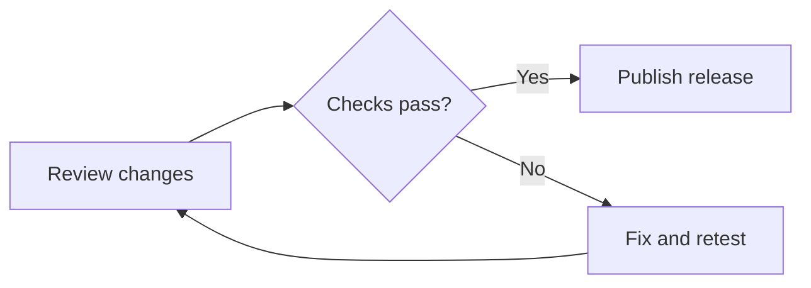
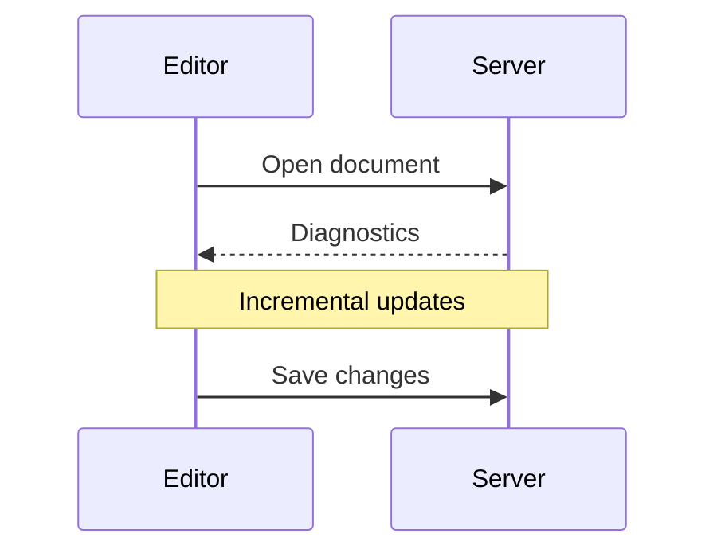

# Rendered Markdown

Open a Markdown file and click the book icon (**Render Markdown**) at the top-right of the editor pane. Click the code icon (**Show Source**) to return to editing. Nucleotide recognizes `.md`, `.markdown`, `.mdown`, `.mkd` and `.mkdn` files.

The rendered view supports headings, links, images, syntax-highlighted code blocks, nested lists, task lists, block quotes, GitHub-style alerts and tables. Prose stays in a centred, bounded-width column that shrinks with the pane. Only level-one and level-two headings have dividers.

## Select and copy text

- Drag over text to select it, including across paragraphs, lists, quotes, table cells and code blocks.
- Shift-click to extend the selection.
- Press **Command-C** on macOS or **Ctrl-C** on Linux and Windows to copy the selection.
- Press **Command-A** on macOS or **Ctrl-A** on Linux and Windows to select all rendered text.
- Click a link to open it. Dragging over link text selects it without opening the link.

Copy uses the displayed text, not Markdown markup. Text fragments are separated by blank lines; copied tables are plain text rather than tabular clipboard data. Image pixels and decorative list markers are not included. Changing the document contents clears the rendered selection.

## Mermaid

The same native Markdown renderer is used for hover and completion documentation.

Fenced code blocks with the `mermaid` language render flowcharts (`flowchart` or
`graph`) and sequence diagrams (`sequenceDiagram`):

````markdown



````

Diagrams use the current Markdown colours, font and text size. Wide diagrams
shrink proportionally to fit the panel. Rendering runs in the background, without
a browser, JavaScript runtime or external rendering service. Visible blocks retain
their results until the source or rendering style changes.

While rendering, the source remains visible. Invalid syntax, unsupported diagram
types and diagrams exceeding the preview limits show a diagnostic and retain the
source instead of displaying an image. Other fenced languages remain ordinary code
blocks. Embedded images are not supported in Mermaid previews.

Preview limits are 64 KiB of Mermaid source, 1,000 model items, 2 MiB of generated
SVG, a five-second cooperative rendering deadline and two concurrent renders.
Raster images are limited to 4,194,304 pixels and 4,096 pixels per edge, including
GPUI's 2× supersampling. Split very large diagrams into smaller blocks.

## Implementation

The integration lives in `crates/nucleotide-ui/src/markdown/mermaid.rs`. Merman
0.8 produces SVG through its `resvg_safe` pipeline; GPUI's existing SVG renderer
converts that output into a full-colour image. GPUI text shaping supplies label
widths to Merman. HTML labels use Merman's SVG-text fallback rather than a browser's
HTML/CSS layout, so complex rich-text labels may differ from Mermaid.js.
